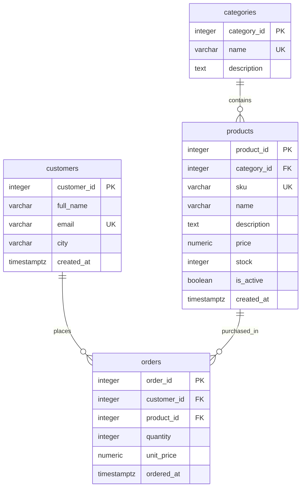

# ROSEVEIL Cosmetics Database — ER diagram

Each product belongs to one category. A category may have no products. Each order references exactly one customer and one product; customers and products may have no orders. Buying two different product types creates two orders in this deliberately simplified assignment. There is no separate cart, order header, or order-items table.

Identity primary keys provide stable references. Category names, product SKUs, and customer emails are unique. Emails must be trimmed and lowercase; the basic format check is not full email validation. All columns are required, with defaults for optional descriptive text, stock, activity, city, and timestamps. Blank names and SKUs are rejected.

Prices use `NUMERIC(10,2)` for exact decimal amounts in one documented currency (USD). Prices can be zero, but cannot be negative or numeric NaN. Stock cannot be negative and order quantities must be positive integers. `TIMESTAMPTZ` records instants; the displayed time zone depends on the session.

`orders.unit_price` is the price paid per unit when purchased. Changing a product's current price does not change historical sales values. Totals are computed as `quantity * unit_price` to avoid redundant stored totals.

All foreign keys use `ON DELETE RESTRICT`: categories containing products and customers/products referenced by orders cannot be deleted. This preserves purchase history. Use `products.is_active = FALSE` to retire a product. Primary keys are stable and should not be edited; default `ON UPDATE NO ACTION` protects references.

The purchase SQL uses a conditional stock update and inserts only from its returned row. PostgreSQL row locking and stock rechecking at READ COMMITTED protect concurrent purchases. Atomicity protects both changes if the insert fails. These scripts do not add triggers or access-control roles: direct manual order inserts do not automatically reduce stock. All new purchases must use the demonstrated pattern, and production access should restrict arbitrary writes. Historical seed orders are the explicit exception because stock is seeded as a current balance.
